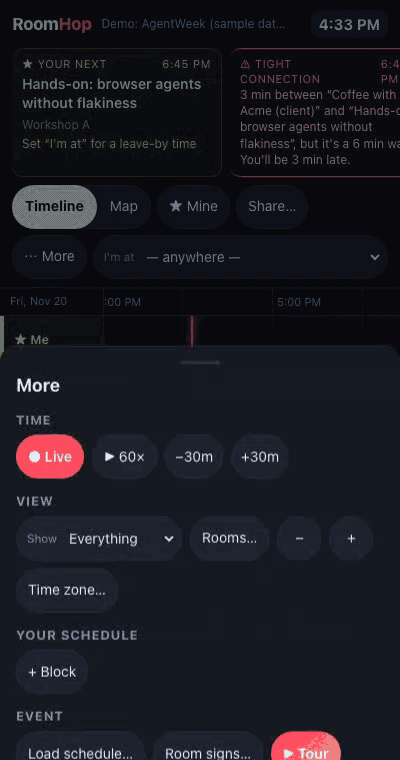
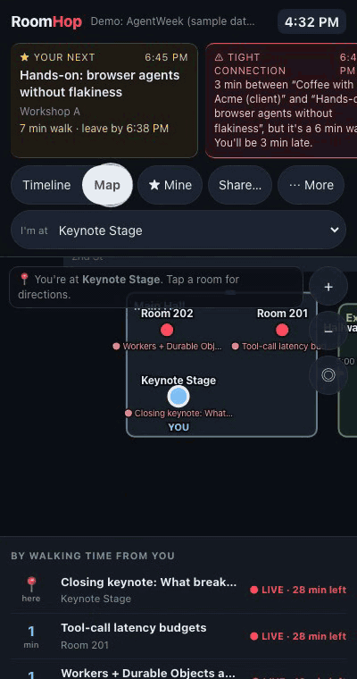
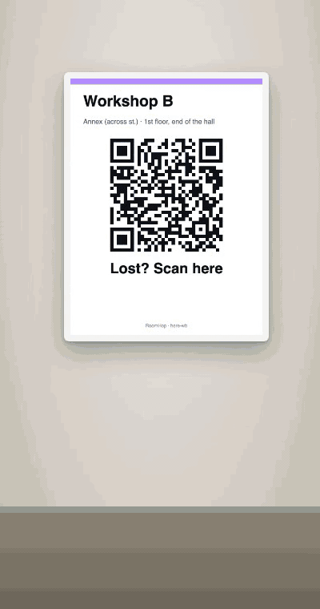

<h1>
  <picture>
    <source media="(prefers-color-scheme: dark)" srcset="assets/brand/logo-dark.svg">
    
  </picture>
</h1>

[](https://github.com/bnelford/nowline/actions/workflows/ci.yml)
[](LICENSE)

**Your conference schedule, live: what's on now, what's next, and whether you'll make the walk.**

### At the event

Open one link on your phone. Every room is a lane, a red line marks the current time, and the strip at
the top shows what's on now and what starts next. Star the sessions you want, and NowLine checks each
connection against the walk between rooms. Scan the QR sign on any room door to see where you are and
how to get to your next session.

### Running the event

There's nothing to install. NowLine reads the Sched, pretalx, Sessionize or `.ics` export you already
publish, so your schedule tool stays the source of truth. Share one link with attendees and print a QR
sign for each room. There are no accounts and no server to run.

**[Try the live demo →](https://bnelford.github.io/nowline/)** The demo's data is generated around the
current time, so it's always mid-conference. **▶ Tour** plays a 90-second walkthrough.

<table>
  <tr>
    <td align="center" width="33%"></td>
    <td align="center" width="33%"></td>
    <td align="center" width="33%"></td>
  </tr>
  <tr>
    <td align="center"><b>What's on now</b>, and whether you'll make your next session</td>
    <td align="center"><b>The walk</b> between rooms, with times and the route</td>
    <td align="center"><b>Lost? Scan here.</b> A room sign tells your phone where you are</td>
  </tr>
</table>

## What it does

- **Live timeline.** Rooms as swim lanes, a now-line, and a now/next strip for what's starting soon.
- **Your agenda, checked.** Star sessions, add your own blocks, or import your calendar. NowLine warns
  about overlaps and connections that are too tight: *"5 min between these, but it's an 8 min walk."*
- **"I'm here" room signs.** Print a QR sign per room. Scanning one tells the phone where you are and
  gives directions and a leave-by time for your next stop.
- **Stays current.** NowLine refreshes the feed while it's open, shows when it last updated
  ("Updated 14:05"), and flags sessions that changed room.
- **Works offline.** Install it to the home screen; the app and the last loaded schedule keep working
  when the venue Wi-Fi doesn't.
- **No account, no backend.** Static files. Stars and blocks stay in your browser. See [PRIVACY.md](PRIVACY.md).

It's not a CFP, ticketing, or schedule-authoring tool. Sessionize, pretalx, Sched and the rest stay the
source of truth; NowLine reads what they already publish.

## Use it with your conference

Open NowLine, choose **⋯ More → Load schedule…**, and give it the event's export:

| Platform | Export |
| --- | --- |
| Sched | Whole-event iCal feed (on the event's Sched site, logged out: *Mobile App + iCal*) |
| pretalx / frab | `…/schedule/export/schedule.json` |
| Sessionize | API "All data" or "Schedule grid" JSON |
| Swapcard, Cvent, others | Whole-event `.ics` |
| Anything else | NowLine's [simple JSON](docs/importing.md#simple-event-json), which can also describe buildings, walk times and routes |

Choosing a file or pasting text always works. Fetching by link goes through a small [feed relay](docs/relay.md),
because schedule sites don't send CORS headers. A public one for Sched, Sessionize and pretalx.com is used by
default; deploy your own for anything else (for example a self-hosted pretalx).

**Share it.** Once a schedule is loaded from its link, **Share…** gives you a link that opens the same
schedule on anyone's phone. Post it in the event's chat. Shared links open in attendee mode, which hides
the organizer tools; add `?admin` to the page link to get them back.

**Add your venue.** A schedule export knows rooms but not buildings. Add `&venue=<url of a venue.json>`
to the shared link to supply buildings, walk times and routes. See [docs/importing.md](docs/importing.md).

**Embed it.** Add `?embed=1` to the page link for a version meant to sit in an iframe on the event's website.

Platform notes, with the exact export URLs: [Sched](docs/platforms/sched.md),
[pretalx](docs/platforms/pretalx.md), [Sessionize](docs/platforms/sessionize.md).

**For organizers:** a printable one-page overview is in [organizers.html](organizers.html), and
[docs/self-host.md](docs/self-host.md) covers running your own copy with your event's branding.

## Run it for your event

1. **Host it.** Fork the repo, then in *Settings → Pages* set *Source* to **GitHub Actions**. The
   [Pages workflow](.github/workflows/pages.yml) tests and publishes the site to
   `https://<you>.github.io/<repo>/` on every push to `main`. Any other static host works too:
   `node scripts/site.js` copies the site into `_site/`, and all paths are relative. To set your
   event's name, colours and default feed, add a `nowline.config.json`; see [docs/self-host.md](docs/self-host.md).
2. **Deploy your own relay** (optional; the public one covers Sched, Sessionize and pretalx.com): `npx wrangler deploy`. See [docs/relay.md](docs/relay.md).
3. **Load the schedule from its feed link and print room signs.** **Print all** prints every room's sign
   in one go. Signs made from a feed-loaded schedule work on any phone, including one that has never
   opened NowLine. See [docs/room-signs.md](docs/room-signs.md).

## Docs

- [Loading a schedule](docs/importing.md): every format, time zones, and the simple JSON format
- [Your agenda](docs/agenda.md): stars, blocks, calendar import, and conflict checks
- [Room signs](docs/room-signs.md): QR links, feed links, and printing
- [Feed relay](docs/relay.md): what it allows, its limits, and deploying it
- [Self-hosting](docs/self-host.md): deploy your own in 5 minutes, `nowline.config.json`, branding, attendee mode, and embedding
- Platforms: [Sched](docs/platforms/sched.md), [pretalx](docs/platforms/pretalx.md), [Sessionize](docs/platforms/sessionize.md)
- [For organizers](organizers.html): a printable one-pager
- [Privacy](PRIVACY.md), [Accessibility](ACCESSIBILITY.md), [Changelog](CHANGELOG.md), [Press kit](docs/press.md)

## Development

NowLine uses ES modules, which browsers won't load from `file://`. Serve the folder over HTTP:

```sh
npm install
npm run serve                     # → http://localhost:8080/  (or: python3 -m http.server 8080)
npm test                          # unit tests (Vitest): importers, .ics parsing, agenda checks, signs, stars, relay
npm run test:coverage             # the same, with a V8 coverage report (src/ and the relay)
npx playwright install chromium   # once
npm run test:e2e                  # Playwright smoke: demo → import → star → conflict → signs → time zones,
                                  # run at / and again under /nowline/ against the staged site, like Pages
```

```
index.html               markup + CSS; loads vendor/qrcode.js and src/app.js
src/app.js               UI: rendering, sheets, map, tour, storage
src/schedule.js          normalized model + JSON importers (pretalx/frab, Sessionize, simple)
src/ics.js               .ics parsing and whole-event calendar import
src/agenda.js            walk times and conflict detection
src/tz.js                time zones: Intl-based conversion, labels, per-event zone settings
src/signs.js, stars.js   room-sign links, per-event stars
src/demo.js, samples.js  synthetic demo data, the simple-format example
vendor/qrcode.js         QR Code Generator (MIT), unmodified
assets/tour/*.mp3        tour voiceover
assets/brand/            logo, mark, monochrome variants, favicon and app icons
fixtures/                sample exports used by tests
nowline-feed-relay.js    optional Cloudflare Worker (wrangler.toml)
scripts/serve.js         static dev server (--base /nowline/ serves under a sub-path)
scripts/site.js          copies the site files into _site/ for deployment
scripts/badges.js        writes the coverage/test-count badge JSON from test reports (pages.yml)
```

See [CONTRIBUTING.md](CONTRIBUTING.md) for guidelines. The short version: no bundler, no framework,
no required backend.

## License

NowLine is licensed under the [Apache License 2.0](LICENSE), © 2026 Beau Nelford. Third-party material
keeps its own license; see [THIRD_PARTY.md](THIRD_PARTY.md) and [NOTICE](NOTICE). This includes the
MIT-licensed QR Code Generator by Kazuhiko Arase, and voiceover generated with Kokoro-82M (Apache-2.0).
"QR Code" is a registered trademark of DENSO WAVE INCORPORATED.
