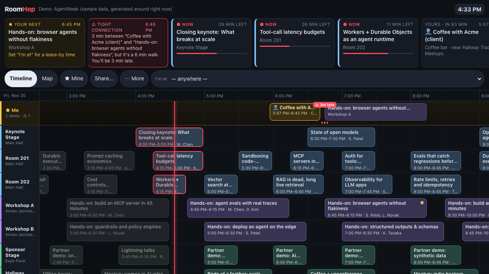

<h1>
  <picture>
    <source media="(prefers-color-scheme: dark)" srcset="assets/brand/logo-dark.svg">
    
  </picture>
</h1>

[](https://github.com/bnelford/nowline/actions/workflows/ci.yml)
[](https://github.com/bnelford/nowline/actions/workflows/pages.yml)
[](https://github.com/bnelford/nowline/actions/workflows/pages.yml)
[](https://github.com/bnelford/nowline/actions/workflows/pages.yml)
[](https://scorecard.dev/viewer/?uri=github.com/bnelford/nowline)
[](LICENSE)
[](https://bnelford.github.io/nowline/)

A live conference timeline for attendees: what's on **now** and **next**, where you are, and whether
you'll make it to your next session in time.

**Live demo:** <https://bnelford.github.io/nowline/>



Every room is a swim lane and a red line marks the current time. NowLine reads the schedule exports
that conference tools already publish. It runs entirely in the browser as static files: no build
step, no account, and no backend.

**What it is**

- A phone-first, attendee-facing view of a published schedule: timeline, now/next strip, and a schematic map.
- A personal agenda. You can star sessions, add your own blocks (meetings, breaks), or import them
  from your calendar. NowLine then checks the walk between consecutive items and warns about overlaps
  and connections that are too tight.
- Printable QR room signs. Scanning one sets "I'm here" and shows directions to your next stop.

**What it is not**

- Not a CFP, registration, ticketing, or schedule-*authoring* system. It complements Sessionize,
  pretalx, Indico, Sched and similar tools: they stay the source of truth, and NowLine reads their exports.
- Not a backend service. Your stars and blocks stay in your browser's `localStorage`. The optional
  [feed relay](#feed-relay-optional) only forwards public schedule feeds.

## Quick start

NowLine uses ES modules, which browsers won't load from `file://` URLs. Serve the folder over
HTTP with any static server:

```sh
npm run serve                  # zero-dependency Node server → http://localhost:8080/
# or
python3 -m http.server 8080    # → http://localhost:8080/
# or
npx serve .
```

Open the page and you'll get the **Demo: AgentWeek** schedule. Its data is synthetic and generated
around the current time, so the now-line always has something on it. The **▶ Tour** button plays a
90-second guided tour, and `#tour` in the URL opens it too.

To host it, copy `index.html`, `src/`, `vendor/` and `assets/` to any static host (GitHub Pages,
Cloudflare Pages, Netlify, S3, an nginx directory). Nothing needs compiling. `node scripts/site.js`
copies exactly those into `_site/`. All paths are relative, so the site also works from a sub-path.

### Deploy your own

**GitHub Pages.** Fork the repo, then in *Settings → Pages* set *Source* to **GitHub Actions**.
[`.github/workflows/pages.yml`](.github/workflows/pages.yml) runs the unit and E2E tests and publishes the
site, along with the coverage and test-count badge data, on every push to `main` (or from *Actions → Deploy to GitHub Pages → Run workflow*). It ends up at
`https://<you>.github.io/<repo>/`, and room signs default to that address.

**Feed relay (optional).** Pages only serves static files, so the [relay](#feed-relay-optional) is
deployed separately as a Cloudflare Worker:

```sh
npx wrangler login
npx wrangler deploy        # uses wrangler.toml → worker "nowline-relay"
```

Then paste its `…/?url=` address into **Relay URL** under **Load schedule…**.

## Loading a schedule

Use **Load schedule…** to choose a file, paste text, or fetch a link (fetching needs the
[relay](#feed-relay-optional)). Tick **Shift dates to today** to try out a past conference as if it
were live: whole days are moved so the first day is today in the event's time zone, keeping each
session's wall-clock time.

| Source | What to load | Notes |
| --- | --- | --- |
| **Sched** (KubeCon, Open Source Summit, …) | The whole-event iCal feed: on the event's Sched site, log out, then go to *Mobile App + iCal* | `LOCATION` becomes the room. "(Level 2)"-style hints group rooms into floors. Titles like `Talk - Speaker, Company` are split into title and speakers. `TZID`, `X-WR-TIMEZONE`, `DURATION` and folded lines are handled. |
| **Swapcard, Cvent**, other whole-event `.ics` | The event calendar export | Parsed the same way as Sched. Only Sched-style feeds are covered by tests. |
| **pretalx / frab** | `schedule.json` (`…/schedule/export/schedule.json`) | Uses the conference title, rooms, `date` + `duration`, `track` (or `type`), persons, and abstract. |
| **Sessionize** | API "All data" JSON | Unscheduled sessions are skipped. Times have no offset or zone, so set the event's zone under **Time zone…** (a top-level `timeZone`/`timezone` is used if present). |
| **Sessionize** | API "Schedule grid" JSON | Same caveat on time zones. |
| **Simple JSON** | See below | The only format that can describe buildings, walk times, room directions and routes. |

### Time zones

Every event has a time zone. NowLine takes it from the schedule when it can: `X-WR-TIMEZONE` or
the events' `TZID` in an `.ics`, `time_zone_name` in pretalx/frab, or `timezone` in simple JSON.
Otherwise it uses the device's zone, and you can set the event's zone under **Time zone…**. Times
written without an offset (Sessionize, floating `.ics` times) are read in the event's zone.

**Time zone…** also picks where times are *shown*: the event's zone (default), your device's zone,
or any IANA zone from a searchable list. The choice is saved per event. When times are shown in a
zone other than the device's, a short label such as `PST` or `UTC+1` appears next to the clock.
"Now", the live timeline, "starting soon", and conflict and walk-time checks all work on real
instants, so they don't change with the display zone. DST is handled through `Intl.DateTimeFormat`.


Everything is converted to one internal shape (documented at the top of [`src/schedule.js`](src/schedule.js)).
Imported schedules without geometry get a schematic map layout and default walk times: 1 minute
within a building and 8 minutes between buildings (3 minutes between floors for `.ics` imports).

### Simple event JSON

```json
{
  "name": "My meetup",
  "buildings": {
    "hq":   { "name": "HQ",   "color": "#7cc4ff", "walk": { "hq": 1, "cafe": 4 } },
    "cafe": { "name": "Cafe", "color": "#ffb066", "walk": { "hq": 4, "cafe": 1 } }
  },
  "timezone": "America/Denver",
  "venues": [
    { "id": "Stage", "name": "Stage", "building": "hq", "where": "Ground floor, through the main doors" },
    { "id": "Cafe",  "name": "Cafe",  "building": "cafe" }
  ],
  "routes": {
    "hq>cafe": "Leave by the front doors and cross the plaza.",
    "cafe>hq": "Cross the plaza to the HQ front doors."
  },
  "sessions": [
    { "title": "Welcome", "start": "2026-11-12T09:00:00-07:00", "end": "2026-11-12T09:30:00-07:00",
      "venue": "Stage", "speakers": ["Host"], "track": "Keynote", "description": "…" },
    { "title": "Coffee chat", "start": "2026-11-12T09:15:00-07:00", "end": "2026-11-12T10:00:00-07:00", "venue": "Cafe" }
  ]
}
```

- `sessions` is required. Each session needs `title`, `start` and `end` (anything `Date` can parse).
  ISO times without an offset, like `2026-11-12T09:00`, are read in `timezone`.
- `timezone` (optional) is the event's IANA zone, for example `"Europe/Brussels"`. `venue` (or `room`) defaults to `"Main"`. `speakers` may be a list, or a
  single `speaker` string. `id` is optional.
- `buildings[*].walk` gives minutes from this building to each other building.
- `venues[*].where` is shown in directions and on signs. `routes` holds turn-by-turn text keyed by
  `"<from building id>><to building id>"`, for example `"hq>cafe"`.
- A bare array of sessions also works.
- This example (without `timezone`) is [`fixtures/simple.json`](fixtures/simple.json), and is also
  available in the app as **Insert simple example**. [`fixtures/simple-tz.json`](fixtures/simple-tz.json)
  shows `timezone` with offset-less times.

## Your agenda

- **☆ Add to my schedule** on a session stars it. Stars are saved per event (by schedule name).
  Stars saved by older versions in one shared list move to an event only when that event has a
  session with the same id; the rest wait for the event they belong to.
- **+ Block**, or tapping an empty slot in a lane, adds your own time block. You can attach it to a room.
- **Import .ics…** in the *Me* lane adds events from your own calendar export as blocks.
- After every change NowLine re-checks for overlaps and for walks longer than the gap, and shows
  warnings in the now/next strip, on the *Me* lane, and in the session sheet.

## Room signs

**Room signs…** generates one printable PNG sign per room, each with a QR code that links to
`<page link>#here-<room-slug>`. Opening that link sets "I'm here" to the room and shows what's on
there, plus directions and a leave-by time for your next stop.

If the schedule was loaded **from a link** (Load schedule… → From a link), the QR link also carries
that feed, plus the relay used to fetch it: `<page link>?feed=<feed URL>&relay=<relay URL>#here-<room-slug>`.
If the feed has no time zone of its own and you set one under **Time zone…**, the link also carries
`&tz=<zone>`, so a scanning phone reads the feed's times in the same zone.
A phone that has never opened NowLine fetches the schedule from it on the first scan, then jumps to
the room. If a different imported schedule is already stored on the phone, NowLine asks before
replacing it. The `feed`/`relay`/`tz` parameters are removed from the address bar once handled.

The **Page link** defaults to the page you have open, without its `#fragment`. Before printing,
make sure it's the public URL attendees will be able to open. If you host the page somewhere
other than where you're generating signs, set **Page link** to that URL.

If the schedule was loaded from a **file or pasted text**, there's no link to carry, so the QR link
only identifies the room. The sign generator warns about this: a scan only works on a phone that
already has the same schedule loaded, and shows the demo otherwise. Load the schedule from its feed
link and regenerate the signs to fix that. Older room-only sign links keep working as before.

Keep the feed URL stable for the event: if it changes, printed signs keep pointing at the old one.

## Feed relay (optional)

Sched, Sessionize and pretalx don't send CORS headers, so a browser can't fetch their feeds
directly. [`nowline-feed-relay.js`](nowline-feed-relay.js) is a small Cloudflare Worker that does
that one job:

- Hosts are allow-listed by exact name, set by `ALLOWED_HOSTS` in [`wrangler.toml`](wrangler.toml).
  The default is `sched.com .sched.com sessionize.com .sessionize.com pretalx.com`. An entry with a
  leading dot matches any subdomain (`.sched.com` covers `kccncna2026.sched.com`). Only use those for
  domains whose subdomains are all run by the platform. Add self-hosted pretalx instances by exact
  name, for example `ALLOWED_HOSTS = "… pretalx.fosdem.org"`.
- Targets must be `https` on the default port, with no username or password in the URL. IP
  literals, `localhost` and local names (`*.local`, `*.internal`, single-label hosts) are always
  refused, even if listed. Redirects are followed manually (at most 3) and each hop is re-checked.
- Only `GET`/`OPTIONS` requests are accepted. Upstream fetches time out after 10 seconds (504) and
  responses over 10 MB are refused (502).
- Responses are cached at the edge for 5 minutes and sent with `Access-Control-Allow-Origin: *`.

```sh
npx wrangler deploy        # uses wrangler.toml → worker "nowline-relay"
```

Then paste `https://nowline-relay.<your-subdomain>.workers.dev/?url=` into the **Relay URL** field
under **Load schedule…**.

> The relay checks hostnames, not resolved IP addresses. An allowed host's DNS is trusted as-is.

## Development

```sh
npm install
npm test                          # unit tests (Vitest): importers, .ics parsing, agenda checks, signs, stars, relay
npm run test:coverage             # the same, with a V8 coverage report (src/ and the relay)
npx playwright install chromium   # once
npm run test:e2e                  # Playwright smoke: demo → import → star → conflict → signs → time zones,
                                  # run at / and again under /nowline/ against the staged site, like Pages
```

```
index.html               markup + CSS; loads vendor/qrcode.js and src/app.js
src/app.js               UI: rendering, sheets, map, tour, storage
src/schedule.js          normalized model + JSON importers (pretalx/frab, Sessionize, simple)
src/ics.js               .ics parsing and whole-event calendar import
src/agenda.js            walk times and conflict detection
src/tz.js                time zones: Intl-based conversion, labels, per-event zone settings
src/signs.js, stars.js   room-sign links, per-event stars
src/demo.js, samples.js  synthetic demo data, the simple-format example
vendor/qrcode.js         QR Code Generator (MIT), unmodified
assets/tour/*.mp3        tour voiceover
assets/brand/            logo, mark, monochrome variants, favicon and app icons
fixtures/                sample exports used by tests
nowline-feed-relay.js    optional Cloudflare Worker (wrangler.toml)
scripts/serve.js         static dev server (--base /nowline/ serves under a sub-path)
scripts/site.js          copies the site files into _site/ for deployment
scripts/badges.js        writes the coverage/test-count badge JSON from test reports (pages.yml)
```

See [CONTRIBUTING.md](CONTRIBUTING.md) for guidelines. The short version: no bundler, no framework,
no required backend.

## License

NowLine is licensed under the [Apache License 2.0](LICENSE), © 2026 Beau Nelford. Third-party material
keeps its own license; see [THIRD_PARTY.md](THIRD_PARTY.md) and [NOTICE](NOTICE). This includes the
MIT-licensed QR Code Generator by Kazuhiko Arase, and voiceover generated with Kokoro-82M (Apache-2.0).
"QR Code" is a registered trademark of DENSO WAVE INCORPORATED.
